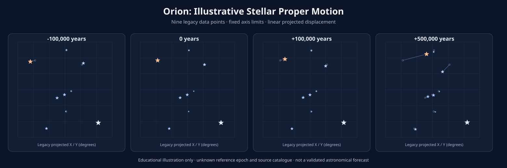

# Orion Stellar Motion

**An educational Python visualization of the apparent displacement of nine stars in an Orion-based classroom dataset.**

## Overview

This project revisits an earlier astronomy-and-programming exercise. It explores how a simplified set of stellar positions changes when constant **proper-motion components** are extrapolated over time. It illustrates the scientific workflow of loading data, applying a mathematical model, visualizing results, and documenting assumptions.

> [!IMPORTANT]
> **Educational demonstration, not a validated astronomical prediction.** The nine input coordinates and proper-motion values were recovered from the original student project, but their catalogue sources, reference epoch, and coordinate frame are not documented. The original X values are negative, so these must **not** be treated as verified ICRS right ascensions. The model uses 2-D linear displacement and neglects stellar distance, radial velocity, perspective effects, and acceleration. Very long extrapolations are especially uncertain.

## Features

- Original nine-point input dataset separated into an editable CSV file
- Reusable data-loading and coordinate-propagation functions
- Explicit conversion from milliarcseconds per year to degrees
- Side-by-side plots with **consistent** axis limits
- Visual differentiation by a *qualitative* temperature palette and magnitude-related marker areas
- Configurable epoch offsets and PNG output path through command-line options
- Unit tests for data loading, displacement, and display properties

## Quick start

Use Python 3.10 or newer.

~~~bash
python3 -m venv .venv
source .venv/bin/activate
pip install -r requirements.txt
python orion_motion.py
~~~

**Windows PowerShell:** after creating the environment, activate with .venv\Scripts\Activate.ps1.

The Python script saves its default output as figures/orion_evolution.png. A static SVG preview is included in this repository for easy viewing on GitHub.

For custom time offsets:

~~~bash
python orion_motion.py --years -10000 0 10000 50000 --output figures/custom_epochs.png
~~~

Run tests:

~~~bash
python -m unittest discover -s tests -v
~~~

## Model

For each legacy projected coordinate, the model applies:

~~~text
x(t) = x0 + mu_x * t / 3,600,000
y(t) = y0 + mu_y * t / 3,600,000
~~~

Here, x and y are in degrees, t is a time offset in years, and the supplied proper-motion components are assumed to be in milliarcseconds per year. **1 degree = 3,600,000 milliarcseconds.**

These are simplified *projected-coordinate* calculations; they are **not** a complete celestial-coordinate transformation. The year values are **offsets from an unspecified reference epoch**, not absolute Gregorian calendar years. Colors are an illustrative temperature-based gradient rather than calibrated blackbody RGB. Marker areas are for legibility, not for photometric analysis.

## Repository structure

~~~text
orion-stellar-motion/
├── data/orion_legacy.csv      # Values transcribed from the original student project
├── figures/orion_evolution.svg # Static GitHub preview
├── tests/test_orion_motion.py
├── orion_motion.py            # Revised, modular Python program
├── requirements.txt
├── .gitignore
└── README.md
~~~

## Background and provenance

This project originated as a student astronomy exercise implemented with Python / Google Colab. The legacy file contained nine positions, effective temperatures, visual magnitudes, and proper-motion components. The present implementation rewrites the plotting and color code, makes assumptions explicit, and adds basic tests. **The original sources for the numeric stellar measurements remain to be verified.**

A relevant congress presentation or certificate may be added here once the event, relationship to the project, and permission to publish the certificate are confirmed.

## Possible next steps

1. Identify each star and verify the observational data against a cited catalogue (e.g., Gaia DR3).
2. Record the catalogue reference epoch and celestial reference frame.
3. Use astropy.coordinates.SkyCoord and apply_space_motion() with proper motion, distance/parallax, and radial velocity when available.
4. Compare the scientifically updated model with this historical demonstration and discuss uncertainties.

For more rigorous coordinate handling, see the [Astropy SkyCoord documentation](https://docs.astropy.org/en/stable/api/astropy.coordinates.SkyCoord.html) and [Accounting for Space Motion](https://docs.astropy.org/en/stable/coordinates/apply_space_motion.html).

## Author

**Vicente Fredes** · Medical student, University of Chile · [GitHub](https://github.com/vfredessresearch)

**Code reuse:** No open-source license has been selected yet. Public visibility does not automatically grant redistribution or reuse rights.
